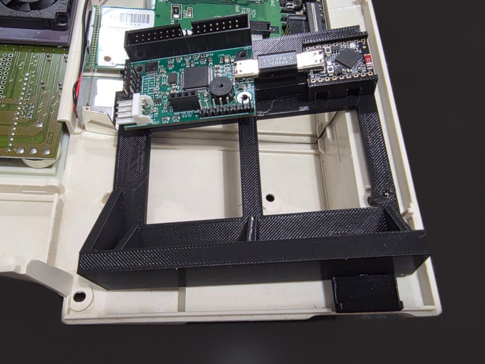
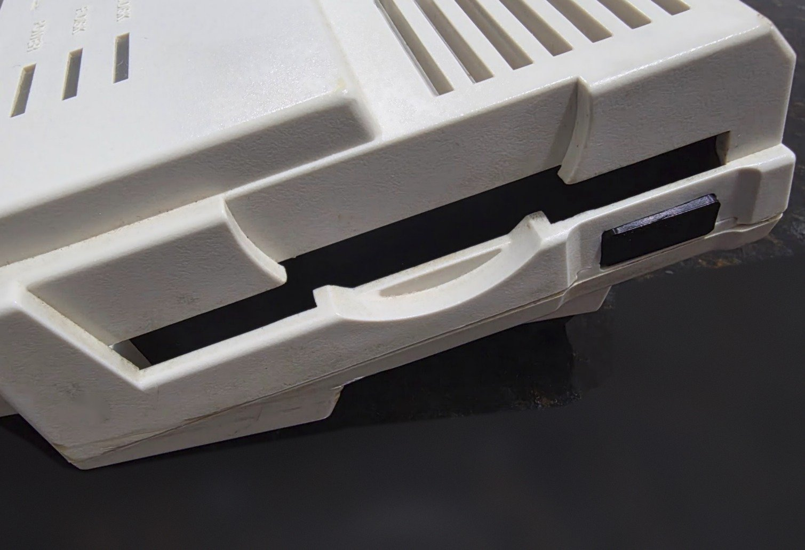
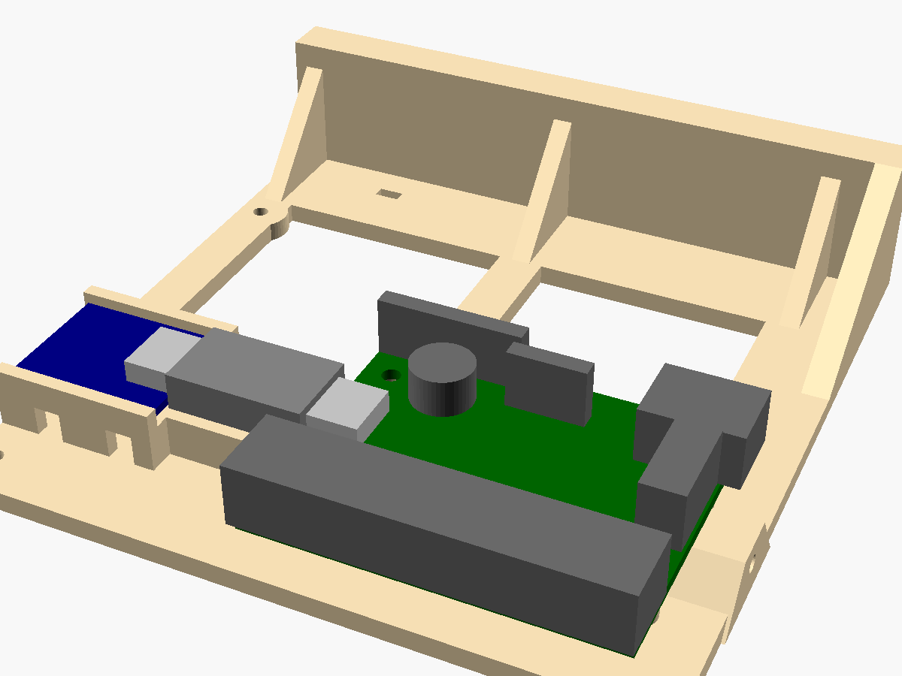
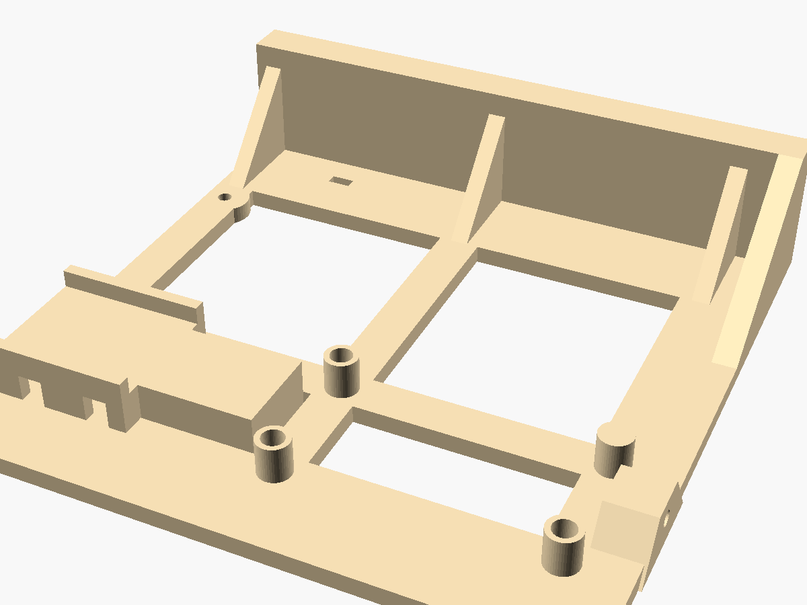
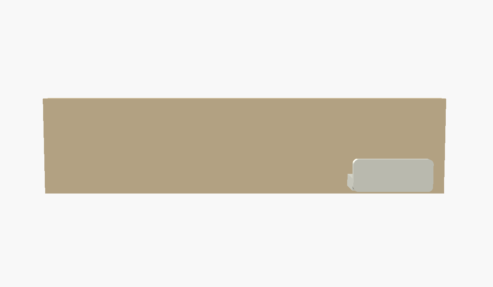
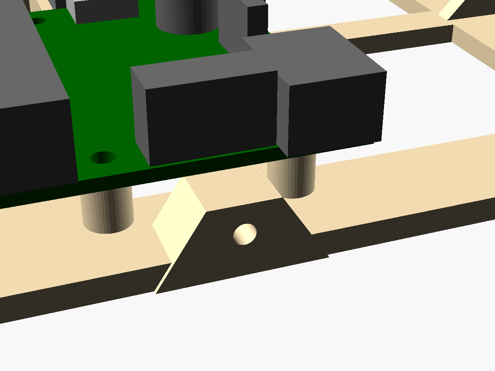
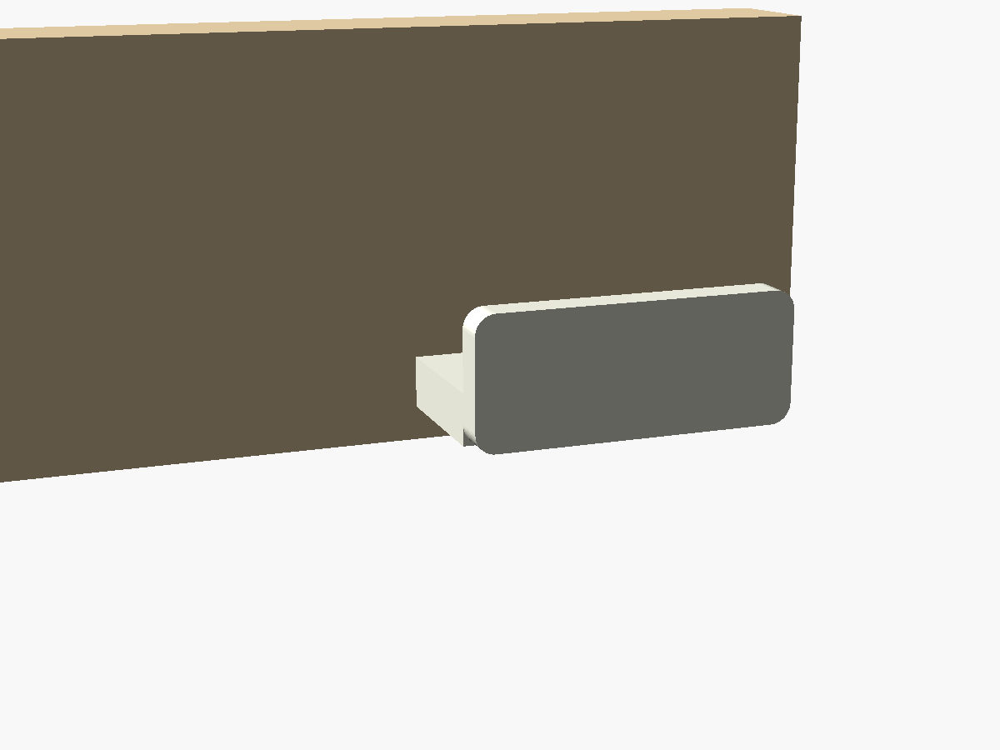
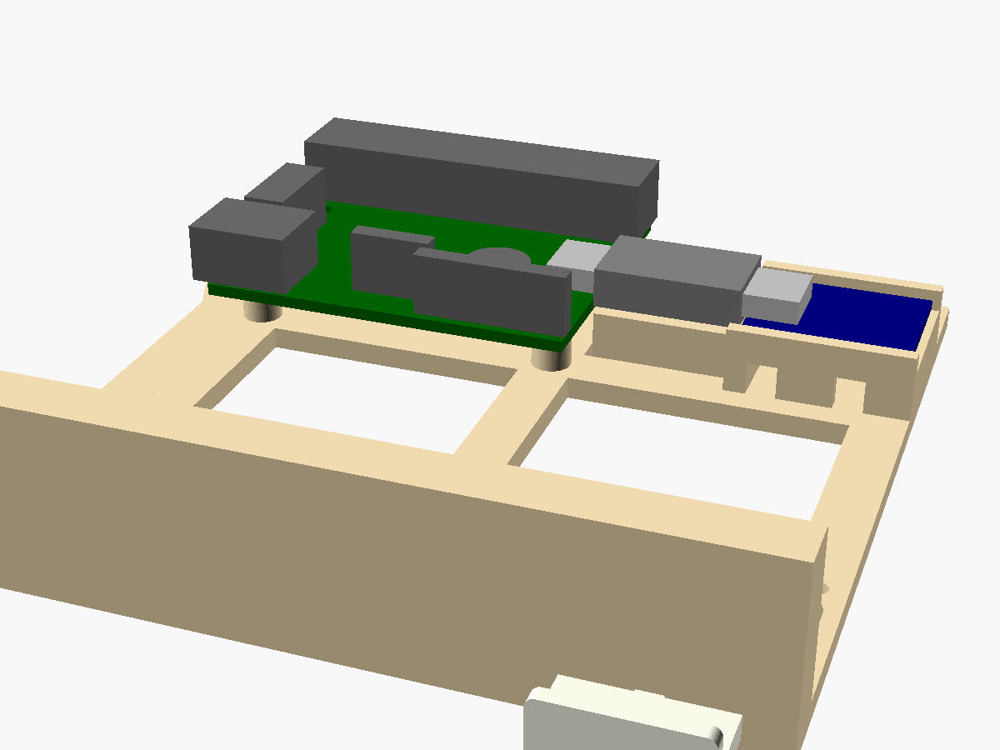

# Amiga 1200 internal bracket

A 3D-printed bracket that fits the Nano-Tek inside an Amiga 1200, in place of the internal floppy drive. It uses the factory drive mounting points, so the case doesn't need cutting.

It's the A1200 counterpart of the [Amiga 500 bracket](../a500-internal-bracket/): the board, ESP32 cradle and layout are the same, and only the parts that meet the case differ.



- Screws to the two factory drive screw points underneath (both on the left-hand rail), plus the drive's sideways fixing on the right-hand side.
- A full-width, 24 mm front wall blanks off the floppy slot. It sits 4 mm further back than the original drive's front so the top case clears it.
- A dummy eject button fills the case's eject-button hole.
- The Nano-Tek sits at the rear, with its 34-pin header on the rear edge where a real drive's data connector is.
- A cradle holds an ESP32-S3 SuperMini, plugged into the Nano-Tek's USB-C port through a straight USB-C coupler, so its weight stays off the Nano-Tek's socket.
- The OLED and rotary encoder are mounted elsewhere on the case; this bracket only has zip-tie points for their leads.

## Installed

The photo at the top shows the bracket fitted in an A1200 with the Nano-Tek, ESP32-S3 SuperMini and coupler, before the cables are connected.

From outside, the slot is blanked off and the dummy eject button fills the drive-button hole:



The model, for reference:



## Differences from the A500 bracket

| | A1200 | A500 |
|---|---|---|
| Underside screws | 2, on the left-hand rail (70 mm apart) | 3 (94 × 70 mm pattern) |
| Side screw boss | Right-hand side, 69 mm behind the front | Front-right corner |
| Front wall | 24 mm, full width, set 4 mm back | 29 mm, full width |
| Dummy eject face | 19 × 7.8 mm, 10.5 mm proud of the wall | 17.5 × 6.8 mm, 9 mm proud |
| Board height | 6 mm standoffs (clears the side screw boss) | 5 mm standoffs |

## Files

| File | What it is |
|---|---|
| `nanotek_a1200_bracket.stl` | Main bracket |
| `nanotek_a1200_eject.stl` | Dummy eject button |
| `nanotek_a1200_fitcheck.stl` | Quick, thin test print: screw points, front wall, eject socket, side lug and standoff positions |
| `nanotek_a1200_bracket.scad` | OpenSCAD source; every dimension is a parameter at the top |
| `images/` | Preview renders |





To export a part from the source:

```
openscad -D 'part="bracket"' -o nanotek_a1200_bracket.stl nanotek_a1200_bracket.scad
```

`part` can be `bracket`, `eject`, `fitcheck` or `assembly` (preview with placeholder blocks for the Nano-Tek, coupler and ESP32).

## Parts used

The same as the A500 bracket:

| Part | Link | Notes |
|---|---|---|
| ESP32-S3 SuperMini | [AliExpress](https://www.aliexpress.com/item/1005007785809540.html) | 22.4 × 18 mm PCB; its USB-C socket sticks out 0.6 mm past the board |
| USB-C male-to-male adaptor | [AliExpress](https://www.aliexpress.com/item/1005011783048286.html) | Straight coupler, marked "3.1 TYPE-C 10Gbps"; leaves a 20 mm gap between the Nano-Tek and the ESP32 |

Use an ESP32-S3 (or S2), not a C3, if the ESP32 is to appear to FlashFloppy as a USB stick, and a coupler that passes the USB 2.0 data lines through. The [A500 README](../a500-internal-bracket/README.md#parts-used) has the details.

## Hardware

- 2 × original A1200 drive screws into the 2.5 mm pilot holes underneath, and 1 into the sideways pilot hole in the side lug (or M3 × 6–8 mm screws)
- 3 × M2.5 heat-set inserts (3.6 mm hole, 4.5 mm deep) and 3 × M2.5 × 5 mm screws for the Nano-Tek. For self-tapping screws instead, set `use_inserts = false` (2.1 mm pilot).
- Zip ties: 2 for the ESP32 cradle, plus some for the OLED/encoder leads
- Most likely a longer 34-way IDC ribbon cable and a power extension lead, as on the A500: the factory leads are cut to suit the original drive. See the [A500 README's cable section](../a500-internal-bracket/README.md#cables).



## Printing

- **Bracket:** base flat on the bed, no supports. 3–4 walls, 30 %+ infill around the screw bosses. About 54 g in PETG.
- **Eject button:** face down on the bed, peg pointing up. No supports. Print it in case colour if you like; see [why it's a separate part](../a500-internal-bracket/README.md#why-the-eject-button-is-a-separate-part).
- **Fit check:** about 16 g. Print it first and screw it into the case to check the screw points, slot, eject position and side lug before printing the full bracket.



## Fit notes

- **Top case clearance at the front.** The front wall is set 4 mm back from the original drive's front because the top case hit the front corner on the first fit. `plate_y1` moves it; `eject_reach` must change by the same amount so the eject face stays in its hole.
- **Power plug clearance.** The Nano-Tek's power plug (CN1) goes in from the right-hand side, just in front of the side screw boss.
- **Eject position.** Taken from a reference design. If it's off in your case, adjust `eject_x`, `eject_z` and `eject_reach`.

## Adjusting the design

The main parameters at the top of the `.scad` file:

| Parameter | Value | What it sets |
|---|---|---|
| `nt_x0` | 44 | Nano-Tek left edge (USB-C edge); 46.5 centres the 94 mm run |
| `standoff_h` | 6 | Board height above the base |
| `lug_y`, `lug_z` | −69, 5 | Side screw position |
| `plate_y1`, `plate_h` | 8, 24 | Front wall outer face (4 mm back from the original 12) and height |
| `eject_x`, `eject_z`, `eject_w`, `eject_h`, `eject_reach` | 15, 5.9, 19, 7.8, 10.5 | Eject cap position and size |
| `coupler_gap`, `esp_len` | 20, 22.4 | Coupler gap and ESP32 size (measured) |



## Credits

- Screw points, side lug and eject cap positions measured from _CrazyBob_'s [Amiga 1200 Gotek USB disk drive emulator base](https://www.thingiverse.com/thing:2102839) (CC BY-SA).
- The bracket geometry itself is an independent OpenSCAD design, sharing its layout with the A500 bracket; only the measured positions are reused.
