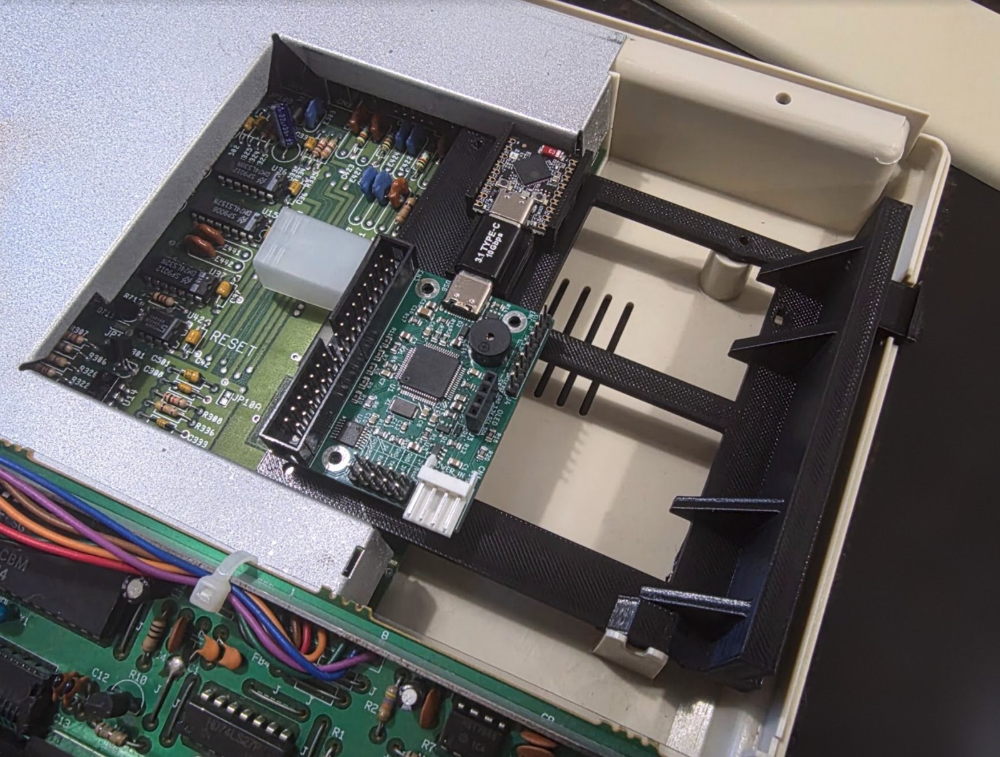
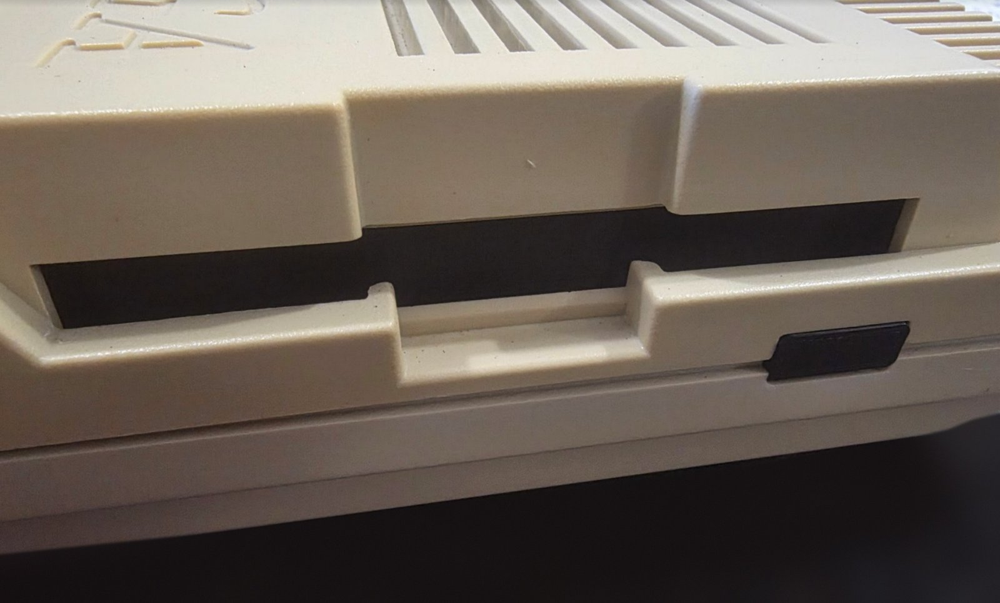
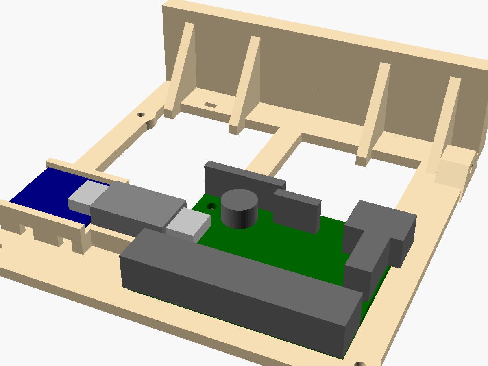
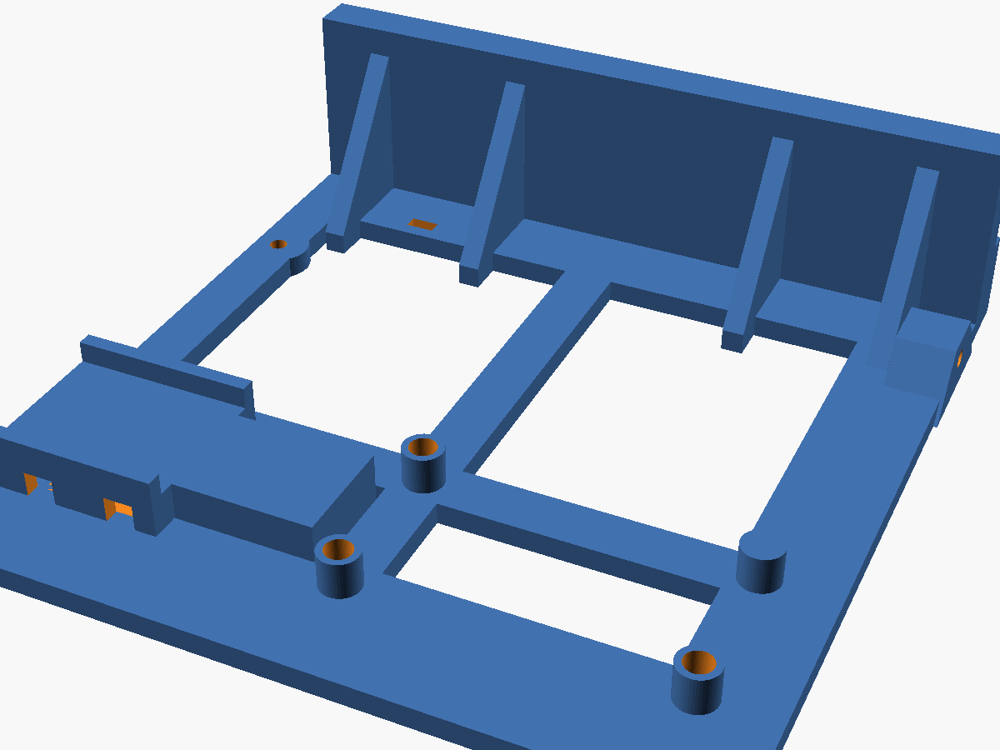
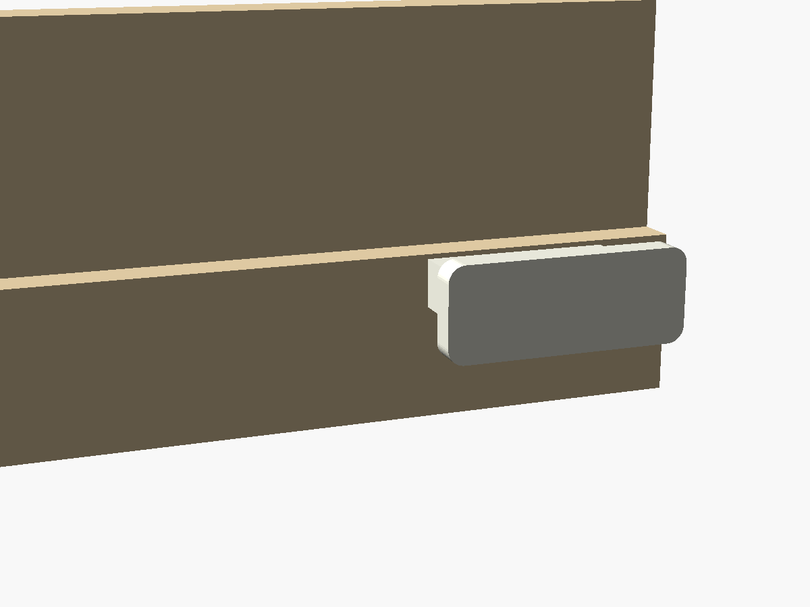
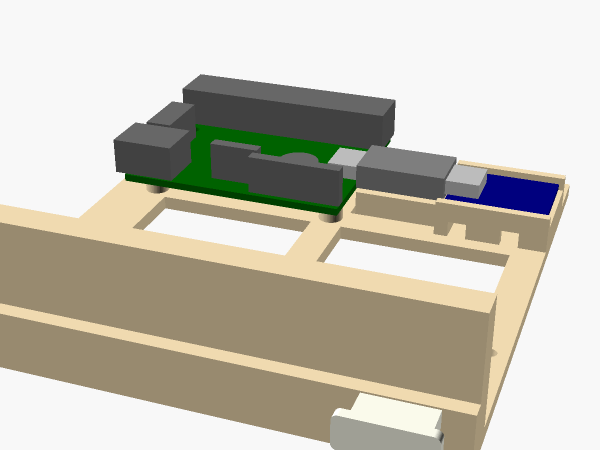

# Amiga 500 internal bracket

A 3D-printed bracket that fits the Nano-Tek inside an Amiga 500, in place of the internal floppy drive. It uses the factory drive mounting points, so the case doesn't need cutting.



- Screws to the three factory drive screw points in the bottom of the case, plus the drive's sideways fixing at the front-right corner. Fits both Rev A and Rev B A500 cases.
- A solid front plate blanks off the floppy slot.
- A dummy eject button fills the case's eject-button hole.
- The Nano-Tek sits at the rear, with its 34-pin header on the rear edge where a real drive's data connector is.
- A cradle holds an ESP32-S3 SuperMini, plugged into the Nano-Tek's USB-C port through a straight USB-C coupler, so its weight stays off the Nano-Tek's socket.
- The OLED and rotary encoder are mounted elsewhere on the case; this bracket only has zip-tie points for their leads.

## Installed

The photo at the top shows the bracket fitted in an A500 with the Nano-Tek, ESP32-S3 SuperMini and coupler, before the cables are connected.

From outside, the slot is blanked off and the dummy eject button fills the eject hole:



The model, for reference:



## Files

| File | What it is |
|---|---|
| `nanotek_a500_bracket.stl` | Main bracket |
| `nanotek_a500_eject.stl` | Dummy eject button |
| `nanotek_a500_fitcheck.stl` | Quick, thin test print: screw points, front plate, eject socket, side lug and standoff positions |
| `nanotek_a500_bracket.scad` | OpenSCAD source; every dimension is a parameter at the top |
| `images/` | Preview renders |



To export a part from the source:

```
openscad -D 'part="bracket"' -o nanotek_a500_bracket.stl nanotek_a500_bracket.scad
```

`part` can be `bracket`, `eject`, `fitcheck` or `assembly` (preview with placeholder blocks for the Nano-Tek, coupler and ESP32).

## Parts used

| Part | Link | Notes |
|---|---|---|
| ESP32-S3 SuperMini | [AliExpress](https://www.aliexpress.com/item/1005007785809540.html) | 22.4 × 18 mm PCB; its USB-C socket sticks out 0.6 mm past the board |
| USB-C male-to-male adaptor | [AliExpress](https://www.aliexpress.com/item/1005011783048286.html) | Straight coupler, marked "3.1 TYPE-C 10Gbps"; leaves a 20 mm gap between the Nano-Tek and the ESP32 |

Measured with both plugged together, the ESP32 + coupler + Nano-Tek run is 94 mm long, which fits within the 101 mm bracket.

**Use an ESP32-S3 (or S2), not a C3,** if the ESP32 is to appear to FlashFloppy as a USB stick. The C3 has no USB device controller. **The coupler must pass the USB 2.0 data lines through;** some cheap couplers only pass power.

The Nano-Tek's USB-C port is a host port with the USB-C source resistors and a firmware-controlled power switch, so it powers the ESP32 and sees its data lines through the coupler.

## Hardware

- 3 × original A500 drive screws into the 2.5 mm pilot holes underneath, and 1 into the sideways pilot hole in the side lug (or M3 × 6–8 mm screws)
- 3 × M2.5 heat-set inserts (3.6 mm hole, 4.5 mm deep) and 3 × M2.5 × 5 mm screws for the Nano-Tek. For self-tapping screws instead, set `use_inserts = false` (2.1 mm pilot).


- Zip ties: 2 for the ESP32 cradle, plus some for the OLED/encoder leads
- **A longer 34-way IDC ribbon cable and a power extension lead.** The factory A500 leads are cut to exactly suit the original drive and won't reach. See [Cables](#cables).

## Printing

- **Bracket:** base flat on the bed, no supports. 3–4 walls, 30 %+ infill around the screw bosses. About 57 g in PETG.
- **Eject button:** face down on the bed, peg pointing up. No supports.
- **Fit check:** about 17 g. Optional; print it first to check the screw points, slot and eject positions against your case before printing the full bracket.

Material is a slicer choice: PETG and ABS/ASA both work.

## Why the eject button is a separate part

- **It prints cleanly on its own.** The button sticks out 9 mm sideways from the front lip. Printed as part of the bracket (base flat on the bed), it would be an overhang needing supports, which would mark the one face that's visible from outside the case. Printed separately, face down, it needs no supports.
- **It can match the case colour.** It's the only printed part you can see from outside, so you can print it in beige and the bracket in whatever filament you have.
- **It's quick to change.** If your case's eject hole differs, you only reprint a 1 g part, not the bracket.

It pushes into a square socket in the front lip; add a drop of glue if it's loose.



## Cables

The factory A500 cables are made to the exact length for the original drive, so they don't reach the Nano-Tek's connectors here.

**34-way data cable**
- Use a straight-through cable with no twist. The A500's internal drive (DF0) is selected straight through; a PC floppy cable with the twisted section won't work.
- Two 34-way IDC sockets on 1.27 mm-pitch ribbon, pressed in a vice or IDC crimp tool. Line up pin 1 (the red stripe) with pin 1 on the motherboard header and on CN3.

**Power**
- A 4-pin floppy (mini-Berg) male-to-female extension between the original A500 plug and CN1 leaves the stock lead untouched.
- CN1 only uses +5 V (pin 1) and ground (pins 2 and 3); pin 4 (+12 V) isn't connected.
- Check the plug's orientation before powering up: these connectors can be pushed in upside down or one pin off.

## Adjusting the design

The main parameters at the top of the `.scad` file:

| Parameter | Value | What it sets |
|---|---|---|
| `nt_x0` | 44 | Nano-Tek left edge (USB-C edge). The ESP32 end sits 1 mm inside the left edge, and CN1 ends 3.5 mm inside the right edge. 46.5 centres the run. |
| `coupler_gap`, `esp_len`, `esp_usb_overhang` | 20, 22.4, 0.6 | Coupler gap and ESP32 size (measured) |
| `coupler_w`, `coupler_h` | 12, 5.5 | Coupler body size (estimated); sets the support under the coupler |
| `eject_x`, `eject_z`, `eject_w`, `eject_h`, `eject_reach` | 12.25, 9.9, 17.5, 6.8, 9 | Eject cap position and size |
| `standoff_h` | 5 | Board height above the base |
| `use_inserts` | true | Heat-set inserts or self-tapping pilots for the board |



## Credits

- Case screw positions (94.0 × 70.0 mm pattern) and front-plate envelope measured from [jbilander/gotek_internal_a500_mount](https://github.com/jbilander/gotek_internal_a500_mount) (GPL-2), which fits both A500 case revisions.
- Eject cap and side lug positions measured from _CrazyBob_'s [Amiga 500 Gotek USB bracket v2](https://www.thingiverse.com/thing:2745049) (CC BY-SA).
- The bracket geometry itself is an independent OpenSCAD design; only the measured positions are reused.
